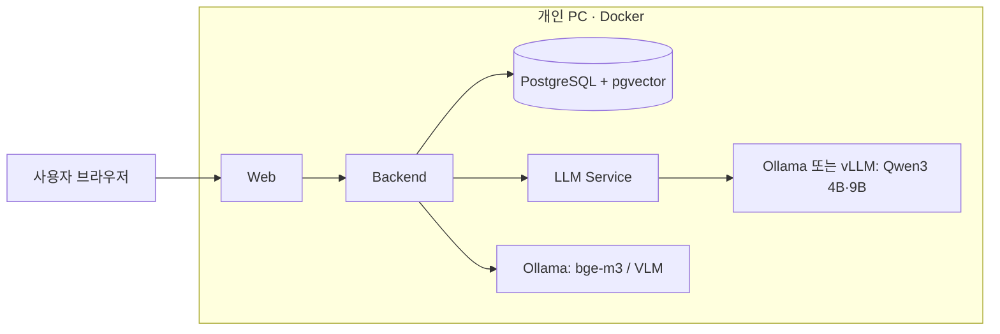

# 연구 설명서 (논문 작성용 자료) — 초안

- 대상: IAAI 2026 제24회 국내학술대회 (국제인공지능학회), 2026.11.19~20, 서울과학기술대학교, 오프라인 발표
- 양식: A4 2단, 약 2쪽 단편 논문 (`IAAI 2026_국내_Paper_Form.hwp`)
- 일정: 논문 제출 **10/30(금)**, 등록 11/6(금)
- 작성 기준: 저장소 `build/payload` 소스와 루트의 검증 문서. 모든 주장에 근거 파일을 괄호로 표시함
- 표기: 코드·문서로 확인되지 않은 내용은 **[확인 필요: …]**로 표시함

---

## 0. 제목 · 요약 · 키워드

### 제목 후보

1. **근거 검증 기반 로컬 LLM 발표 예상 질문 생성 시스템**
   *A Local LLM-based Expected Question Generation System for Presentation Practice with Evidence Verification*
2. **페르소나 기반 발표 연습을 위한 온디바이스 RAG 시스템의 환각 억제 설계**
   *Hallucination-Suppressing Design of an On-Device RAG System for Persona-based Presentation Practice*
3. **원문 인용 검증을 적용한 다중 페르소나 발표 질의 생성 플랫폼**
   *A Multi-Persona Presentation Question Generation Platform with Source Quotation Verification*

> 추천은 1번. "로컬 실행"과 "근거 검증"이 이 시스템의 두 가지 차별점이기 때문.
> 저장소 이름은 "Metaverse"지만 구현된 기능은 발표 연습 서비스임. [확인 필요: 논문에서 '메타버스'를 언급할지 교수님과 결정]

### 요약 초안 (5~6줄 분량)

본 논문에서는 발표자가 업로드한 발표 자료를 바탕으로 서로 다른 관점의 평가자(페르소나)가 던질 예상 질문을 생성하는 로컬 LLM 기반 발표 연습 시스템을 제안한다. 제안 시스템은 외부 AI API 없이 개인 PC에서 4B급 소형 언어모델(Qwen3)과 bge-m3 임베딩, pgvector를 이용한 하이브리드 검색(벡터+BM25, 순위 융합)으로 동작하여 발표 자료의 외부 유출을 막는다. 또한 소형 모델의 환각을 줄이기 위해 페르소나 특성의 원문 인용 검증, 예상 질문의 근거 ID·고유 용어·수치 일치 검증, 답변 문장 단위 근거 점수 검증의 3단계 검증 계층을 설계하였다. 실험 결과 [확인 필요: 모델별 응답 시간, 검증 통과율 등 핵심 수치 1~2개]를 확인하였다. 제안 시스템은 Docker 기반 단일 설치 파일로 배포되어 일반 사용자도 GPU 없이 사용할 수 있다.

### 키워드 (4개)

로컬 대형언어모델(Local LLM), 검색 증강 생성(RAG), 환각 억제(Hallucination Mitigation), 발표 연습(Presentation Practice)

---

## 1. 서론 재료

### 문제 상황

- 발표·심사(캡스톤, 창업 심사, 학위 발표 등)를 준비하는 사람은 심사위원이 어떤 관점에서 질문할지 미리 대비하기 어렵다.
- 범용 챗봇에 자료를 넣으면 두 가지 문제가 있다.
  - **자료 유출 위험:** 미공개 발표 자료가 외부 클라우드 서버로 전송된다.
  - **환각:** 자료에 없는 수치나 근거를 지어낸 질문이 생성된다. 특히 비용 때문에 로컬에서 쓰는 소형 모델(4B급)에서 심하다.
- 질문자의 관점(기술 검토자, 예산 담당자, 사용자 경험 연구자 등)에 따라 질문이 달라져야 하지만, 단순 프롬프트만으로는 관점 차이가 잘 드러나지 않는다.

### 로컬 실행이 필요한 이유

- 최초 설치 이후에는 외부 AI API 없이 동작한다. (`사용방법.txt`)
- 모든 서비스 포트를 127.0.0.1에만 공개하고, DB·AI 포트는 외부에 노출하지 않는다. (`build/payload/compose.yaml`의 web 포트 바인딩, `사용방법.txt`)
- VLM에 클라우드 모델 사용을 금지하고, 허용된 로컬 호스트로만 이미지를 보낸다. (`build/payload/backend/app/integrations/vision.py`)

### 기여 (3개)

1. **완전 로컬 RAG 기반 다중 페르소나 예상 질문 생성 구조.** 발표 자료와 질문자 참고자료를 구분해서 검색하고, 페르소나별로 다른 근거를 찾아 질문을 만든다.
2. **소형 LLM 환각 억제를 위한 3단계 근거 검증 계층.** ① 페르소나 특성 원문 인용 검증, ② 예상 질문 수용 필터, ③ 답변 근거 점수(그라운딩) 검증. 추가 LLM 호출 없이 규칙과 임베딩만으로 수행한다.
3. **일반 사용자용 단일 설치 파일 배포.** WSL·Docker 자동 구성과 모델 선택(4B/9B)을 지원하고, NVIDIA GPU가 감지되면 vLLM으로 자동 전환한다.

---

## 2. 본문 재료

### 2.1 시스템 구성 (그림 1 후보)

| 구성요소 | 역할 | 근거 |
|---|---|---|
| Web (React + Vite, nginx) | 사용자 화면. 127.0.0.1에만 공개하고 Host 헤더를 검증함 | `build/payload/web/`, `nginx.conf`, `EXE_점검_수정결과_20260920.md` |
| Backend (FastAPI) | 인증(JWT), 문서 파싱, 검색(RAG), 페르소나·연습·리뷰·채팅 오케스트레이션 | `build/payload/backend/app/` |
| LLM Service (FastAPI) | 프롬프트 구성, 구조화 출력(JSON 스키마), 긴 문서 map-reduce | `build/payload/llm-service/app/` |
| Ollama | 생성 모델 qwen3:4b / qwen3.5:9b, 임베딩 bge-m3, VLM qwen3-vl:4b-instruct | `build/payload/compose.yaml` |
| vLLM (GPU일 때만) | Qwen3.5-4B w4a16 양자화 모델, 최대 2개 병렬 처리 | `build/payload/compose.gpu.yaml` |
| PostgreSQL + pgvector | 문서 청크, 1024차원 임베딩, 페르소나, 연습 기록 | `build/payload/backend/database/001~014*.sql`, `backend/app/config.py` |

그림 1 초안 (Mermaid, 2단 폭에 맞게 단순화한 형태):

### 2.2 처리 흐름

1. **문서 업로드·파싱:** PDF, PPTX, DOCX를 지원한다. (`backend/app/parsers/`)
   - 시각 분석: 페이지를 최대 1600px 이미지로 렌더링해서 VLM으로 표·차트·도식을 텍스트화한다. 최대 40쪽까지 처리하고, 페이지당 120초, 문서당 600초 제한을 둔다.
   - VLM 결과에는 "AI 해석, 원본 확인 필요" 표시를 붙여 원문과 구분한다. (`backend/app/parsers/visual_parser.py`, `compose.yaml`)
2. **색인:** 청크를 bge-m3로 임베딩해서 pgvector에 저장한다. 청크 내용의 SHA-256 해시와 모델명이 바뀐 청크만 다시 임베딩한다. (`backend/app/services/vector_rag.py`)
3. **페르소나(질문자) 생성:** 이름, 설명, 참고자료(최대 3,000자 발췌)를 입력하면 LLM이 전문 분야와 평가 스타일을 근거 인용과 함께 생성하고, 이어서 검증한다. (`backend/app/services/persona_service.py`)
4. **예상 질문 생성:** 페르소나 1~4명, 발표 자료 1~20개, 페르소나당 질문 1~10개(기본 5개)를 지원한다. (`backend/app/models/practice.py`, `services/practice_service.py`)
5. **연습 대화·리뷰·요약:** 질문별 대화, 자료 리뷰, 요약 기능이 있다. 긴 문서(12,000자 초과)는 map-reduce로 처리한다. (`llm-service/app/review_pipeline.py`, `summary_pipeline.py`)

### 2.3 하이브리드 검색

- **벡터 검색:** pgvector 코사인 거리를 쓴다. 문서별 후보 12개를 뽑고, 거리 0.65 이하만 남겨 최종 6개를 고른다. (`backend/app/config.py`, `services/vector_rag.py`)
- **어휘 검색:** 700자 청크(겹침 100자)에 BM25 방식 점수를 매긴다. 이름이나 수치처럼 임베딩이 놓치는 정확한 표현을 보완하는 역할이다. (`backend/app/services/rag_service.py`의 `DocumentContextSelector`)
- **순위 융합:** Reciprocal Rank Fusion(k=60)을 쓴다. 두 점수 체계를 직접 비교하지 않고 순위만 합친다. (`rag_service.py`의 `fuse_chunk_rankings`)
- **문맥 예산:** 최대 4,000자 안에서 파일별로 분량을 공정하게 나누고, 각 청크에 `[근거 N] 파일 / 구간` 라벨을 붙인다. (`rag_service.py`의 `combine_document_contexts`)
- **질문 생성용 검색 질의:** 페르소나 역할과 설명, 그리고 페르소나 참고자료 최대 2,400자를 질의에 넣는다. 그래서 페르소나마다 서로 다른 발표 근거가 검색된다. (`practice_service.py`)
- **폴백:** 임베딩 색인이 불완전하거나 오류가 나면 "개요 + 관련도" 발췌 방식으로 자동 전환한다. (`practice_service.py`, `source_evidence.py`)

### 2.4 핵심 기법: 3단계 근거 검증 계층 (논문의 중심)

**① 페르소나 특성 원문 인용 검증** (`backend/app/services/persona_service.py`, `models/persona.py`, `특성_근거검증_보완결과.md`)

- LLM이 낸 각 특성(전문 분야, 평가 스타일)에는 근거 인용이 붙는다. 이 인용이 실제 입력(설명 또는 참고자료)에 **문자 그대로 존재하는지** 검사한다.
- 정규화는 NFKC와 공백 제거만 한다. 문장부호, 부정 표현, 어순은 그대로 두어 바꿔 쓴 표현이나 이어 붙인 인용은 통과하지 못하게 했다.
- 유효 문자가 4자 미만인 인용은 기각한다. 2~3자는 특성 값과 같을 때만 허용한다.
- 특성 상태는 `user_stated / supported / inferred / unknown / conflicting` 다섯 가지다. 검증에 실패한 특성은 제외하고 제외 이유를 저장한다. 제외 이유는 `missing_quote`, `model_unknown`, `conflicting`, `zero_confidence`, `reference_changed` 다섯 가지다.
- 참고자료 연결이 바뀌면 그 자료에 기반한 특성을 보수적으로 무효화한다.
- 남은 특성이 하나도 없으면 사용자 설명을 "선언된 평가 기준"으로만 쓴다. 이를 실제 전문 자격으로 꾸미지 않는다.

**② 예상 질문 수용 필터** (`backend/app/services/practice_service.py`의 `accept`)

| 규칙 | 내용 |
|---|---|
| 형식 | 12자 이상, 물음표로 끝남, 키릴·일본 문자가 섞이면 기각 |
| 근거 ID | 모델이 낸 `presentation_evidence_ids`가 실제 **발표 자료** 근거(e1, e2, …)를 가리켜야 함. 질문자 참고자료는 근거로 인정하지 않음 |
| 고유 용어 | 질문과 근거가 공유하는 용어 중 범용어(발표, 방법, 결과 등)와 파일명을 뺀 고유 용어가 1개 이상 있어야 함 |
| 수치 | 질문 속 수치(%, 명, 원, 년 등)가 근거 원문에 그대로 있어야 함 |
| 중복 | 이미 채택한 질문과 자카드 유사도가 0.82 이상이면 기각 |
| 보충 | 3개씩 최대 6회 다시 생성하고, 기각된 질문 목록을 다음 요청에 넘겨 반복을 막음 |
| 상한 | 발표 자료에서 중복을 뺀 내용량에 따라 질문 수 상한을 자동으로 줄임 (`services/content_budget.py`) |

**③ 답변 근거 점수 검증 (그라운딩)** (`backend/app/services/grounding_service.py`)

- 답변을 문장 단위로 나눈 뒤, 각 문장 토큰이 근거 청크에 얼마나 포함되는지 계산한다.
- 포함률이 0.6 이상인 문장은 바로 통과시킨다. 그보다 낮은 애매한 문장만 모아 bge-m3 코사인 유사도로 **한 번에 일괄 재확인**한다. 추가 LLM 호출이 없어서 CPU 환경에서 지연이 두 배가 되는 것을 피한다.
- 임계값은 0.35이고, 근거가 부족한 문장 목록을 보여준다. (`config.py`의 `GROUNDING_THRESHOLD`)
- **주의:** `GROUNDING_MODE` 기본값이 `off`이고 배포 설정(`compose.yaml`)에서도 켜지 않는다. 그래서 배포본에서는 이 검증이 꺼져 있다. 논문에는 "선택 기능"으로 쓰거나, 켜고 측정한 결과를 함께 제시해야 한다. (`config.py`의 `get_grounding_mode`, `services/chat_service.py`)

**보조 장치**

- 리뷰 map 단계의 인용도 원문과 대조한다. 지어낸 인용은 reduce 단계로 넘어가지 않는다. (`llm-service/app/review_pipeline.py`의 `_verify_map_claims`, `backend/app/services/source_evidence.py`의 `verified_sources`)
- 프롬프트 인젝션 방어: 자료는 XML 태그 안에 넣고, 그 안의 지시문을 무시하라는 규칙을 둔다. VLM 해석에는 출처를 밝히게 한다. (`llm-service/app/prompts.py`의 `UNTRUSTED_INPUT_RULE`)
- 출력 언어를 한국어로 고정한다. 소형 모델에서 중국어·일본어가 섞이는 문제를 막기 위해서다. (`prompts.py`의 `OUTPUT_LANGUAGE_RULE`)
- Qwen3의 reasoning 모드를 끄고(`/no_think`) temperature 0.35, 구조화 JSON 출력으로 호출한다. (`llm-service/app/llm_client.py`)

### 2.5 표 1 후보

- **안 A (추천):** 2.4의 "예상 질문 수용 필터" 표를 그대로 쓴다. 기법이 한눈에 보인다.
- **안 B:** 시연 시나리오 표. 발표 자료는 "캠퍼스 분리배출"이고, 페르소나는 기술 아키텍트, 시설운영(예산) 책임자, 학생경험 연구자 3명이다. 각 페르소나의 질문 예시를 1개씩 넣는다. (`시연_예시자료/`, `페르소나_질문오류_수정결과.md`)
  [확인 필요: 실제 생성된 질문 예시 문장을 앱에서 다시 생성해서 넣기]

---

## 3. 모의 실험 재료

### 3.1 현재 있는 검증 결과

| 항목 | 결과 | 근거 |
|---|---|---|
| 단위·통합 테스트 | Backend 243개 통과(6개 건너뜀), LLM 서비스 208개 통과(2개 건너뜀), Frontend 27개 통과 | `검증결과.txt` (2026-09-19) |
| 특성 근거 검증 | 신규 단위 검사 14개, 회귀 검사 3개 통과. 실제 PostgreSQL에서 연결 해제·소유자 격리 확인 | `특성_근거검증_보완결과.md` |
| 시연 데이터 질문 생성 | 페르소나 3명 모두 요청 6개 중 6개 생성. 모델 응답 실패 0건 | `페르소나_질문오류_수정결과.md` |
| 설치 검증 | 설치 시나리오 12개(모의), DB 마이그레이션 001~014 적용, 실제 생성·임베딩 검사 통과 | `검증결과.txt`, `EXE_점검_수정결과_20260920.md` |

> 이 결과들은 **소프트웨어 테스트**라서 논문 "모의 실험"의 성능 결과로 보기는 약하다. 아래 실험 중 1~2개를 추가로 측정해야 한다.
> 참고: 테스트 코드는 이 저장소(배포 payload)에 들어 있지 않음. [확인 필요: 개발 저장소의 tests 폴더 위치]

### 3.2 2일 안에 측정 가능한 실험

모든 실험은 시연 데이터(`시연_예시자료/`의 발표자료 1개, 대본 1개, 페르소나 소스 3개)를 고정 입력으로 쓰는 것을 전제로 한다.

**실험 1 — 모델 크기별 응답 시간 (가장 쉬움, 추천)**

- 조건: qwen3:4b와 qwen3.5:9b 비교. 가능하면 CPU와 GPU(vLLM)도 비교한다.
- 측정: 페르소나 3명 × 질문 5개를 생성하는 총 소요 시간과 페르소나당 평균 시간. 반복 3회 평균을 쓴다.
- 방법: `POST /practice` 계열 API를 호출하고 시간을 잰다. 기존 진단 스크립트 `build/diagnose-practice.py`를 활용할 수 있는지 확인한다.
- 결과 표 (빈칸):

| 모델 | 환경 | 총 시간(s) | 페르소나당(s) | 생성 질문 수 / 요청 수 |
|---|---|---|---|---|
| qwen3:4b | CPU | | | /15 |
| qwen3.5:9b | CPU | | | /15 |
| qwen3:4b | GPU(vLLM) | | | /15 |

[확인 필요: 측정 PC의 CPU, RAM, GPU 사양]

**실험 2 — 검증 필터 효과 (논문 기여와 직결, 추천)**

- 측정: 모델이 낸 후보 질문 중 각 규칙(근거 ID, 고유 용어, 수치, 중복, 형식)에 걸려 기각된 비율.
- 방법: `PracticeService`의 `filter_observer`가 후보마다 처음 걸린 규칙을 기록한다. 측정 스크립트 `build/payload/backend/scripts/measure_practice_filter.py`는 가장 최근 연습 기록(시연 데이터)을 N회 다시 실행하고 집계한다. 새 연습 기록은 저장하지 않는다.
  - 규칙은 형식 → 근거 ID → 고유 용어 → 수치 → 중복 순서로 적용된다. 그래서 후보 1개는 처음 걸린 규칙 하나에만 집계된다. 논문에 이 점을 명시해야 한다.
  - 출력은 `summary.md`(아래 표 형식), `events.jsonl`(원자료), `review_sheet.csv`(사람 판정용) 세 가지다.
- 추가 측정: `review_sheet.csv`의 `unsupported_content(Y/N)` 열에 사람이 "발표 자료에 없는 내용을 주장하는지"를 표시한다. 채택군과 기각군의 Y 비율을 비교하면 필터가 실제로 환각을 걸러내는지 보여 줄 수 있다.

| 단계 | 후보 수 | 기각 수 | 비율 |
|---|---|---|---|
| 형식 | | | |
| 근거 ID | | | |
| 고유 용어 | | | |
| 수치 불일치 | | | |
| 중복 | | | |
| 최종 채택 | | — | |

**실험 3 — 페르소나 간 질문 다양성 (선택)**

- 측정: 페르소나 3명의 질문 집합 사이 평균 자카드 유사도. "참고자료를 연결한 경우"와 "연결하지 않은 경우"를 비교한다. 참고자료를 검색 질의에 넣는 설계가 관점 차이를 키우는지 확인하는 실험이다.

**실험 4 — 사용자 평가 (시간이 되면)**

- 평가자 3~5명이 질문마다 관련성, 구체성, 페르소나 일치도를 5점 척도로 평가한다.

### 3.3 그림 2 후보

- 실험 1의 모델·환경별 막대그래프, 또는 실험 2의 단계별 기각 비율 누적 막대그래프. 2단 폭(약 8cm)에 맞춰 범례는 2~3개 이내로 한다.

---

## 4. 결론 재료

- **성과:** 외부 API 없이 개인 PC에서 동작하는 다중 페르소나 발표 연습 시스템을 구현했다. 소형 모델의 환각을 규칙 기반 검증과 임베딩 검증으로 억제했다.
- **한계** (`특성_근거검증_보완결과.md`, 각 서비스 주석):
  - 원문 인용 일치는 **문자 존재 검증**일 뿐이다. 그 인용이 특성을 논리적으로 뒷받침하는지(의미적 함의)는 검증하지 않는다.
  - 질문 생성에는 4,000자 발췌만 쓰기 때문에 선택되지 않은 부분은 평가하지 않는다. 이 사실은 화면에 경고로 표시된다.
  - 4K 컨텍스트(`LLM_MAX_MODEL_LEN=4096`) 때문에 후보를 작은 묶음으로 반복 생성해야 해서 시간이 늘어난다.
  - 참고자료 기반 특성은 문서 단위가 아니라 전체 묶음 단위로 무효화된다.
  - VLM 해석은 원문 전사가 아니므로 수치 판독 오류가 생길 수 있다.
- **향후 연구:** NLI(자연어 추론) 기반 의미 검증, 근거 위치(문서 ID·구간)의 세밀한 저장, 음성 기반 실시간 질의응답 연습, 사용자 평가 확대.

---

## 5. 참고문헌 후보

검색 키워드: retrieval-augmented generation, hallucination detection, reciprocal rank fusion, BM25, persona-based LLM, question generation, on-device LLM, presentation feedback system

참고문헌 형식 예시 (IEEE 스타일). **실존 여부와 서지 정보는 모두 [확인 필요]**:

1. P. Lewis et al., "Retrieval-Augmented Generation for Knowledge-Intensive NLP Tasks," NeurIPS, 2020. — RAG 원 논문
2. G. V. Cormack, C. L. A. Clarke, S. Buettcher, "Reciprocal Rank Fusion Outperforms Condorcet and Individual Rank Learning Methods," SIGIR, 2009. — RRF
3. S. Robertson, H. Zaragoza, "The Probabilistic Relevance Framework: BM25 and Beyond," Foundations and Trends in IR, 2009. — BM25
4. J. Chen et al., "BGE M3-Embedding: Multi-Lingual, Multi-Functionality, Multi-Granularity Text Embeddings Through Self-Knowledge Distillation," 2024. — bge-m3
5. Qwen Team, "Qwen3 Technical Report," 2025. — 사용 모델
6. Z. Ji et al., "Survey of Hallucination in Natural Language Generation," ACM Computing Surveys, 2023. — 환각
7. W. Kwon et al., "Efficient Memory Management for Large Language Model Serving with PagedAttention," SOSP, 2023. — vLLM
8. 국내 논문 1~2편: AI 발표·면접 코칭, 로컬 LLM 활용 사례. [확인 필요: KCI·RISS 검색]

---

## 6. 저자 · 사사

- Git 기여자: imjae, kunhee-log, 임준혁, lovelovelyst0419-source, CYCL (`git log`)
  [확인 필요: 실명, 소속, 직위, 저자 순서, 교신저자, 이메일]
- [확인 필요: 사업이나 과제 지원 여부. 지원받지 않았다면 사사 문구 삭제]

---

## 7. [확인 필요] 체크리스트

- [ ] 논문 제목 확정, '메타버스' 용어 사용 여부 (교수님)
- [ ] 저자 실명·소속·직위·이메일·저자 순서, 사사 여부
- [ ] **실험 1 측정** (모델별 응답 시간)과 측정 PC 사양
- [ ] **실험 2 측정** (검증 단계별 기각 비율). `measure_practice_filter.py` 실행 후 review_sheet.csv 판정
- [ ] 요약의 실험 결과 문장에 실제 수치 넣기
- [ ] 표 1(안 B로 갈 경우)에 실제 생성 질문 예시 넣기
- [ ] 그림 1 시스템 구성도와 그림 2 실험 그래프를 이미지로 만들기
- [ ] 참고문헌 서지 정보 실존 확인, 국내 논문 1~2편 추가
- [ ] 테스트 코드 위치(개발 저장소) 확인
- [ ] 양식 쪽수 제한을 학회에 확인
- [ ] 발표 형식(Poster / Oral) 결정. Oral이면 등록할 때 iaai@iaai.or.kr로 알리기
